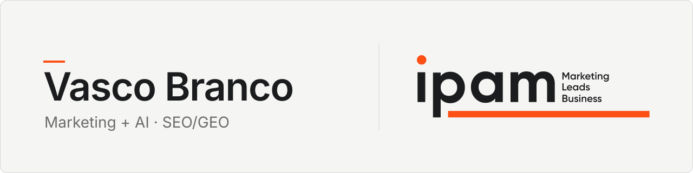
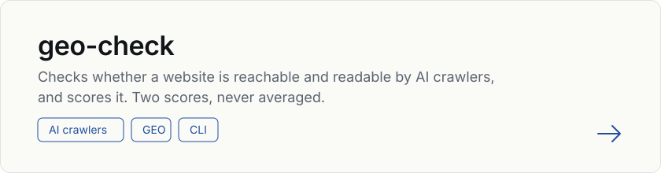

<picture>
  <source media="(prefers-color-scheme: dark)" srcset="assets/banner-ipam-dark-v2.svg">
  
</picture>

I'm Vasco, a Marketing Management student at IPAM Porto, graduating in July 2027.
I build open tools for marketing, GTM and AI.
I am working towards a GTM Engineer role, which combines marketing, data and AI automation.

## What I'm building

[freetools](https://github.com/vasco-branco06/freetools) is an index of open tools for marketing, GTM and AI, built for the Portuguese and Iberian market.

## Featured

<a href="https://github.com/vasco-branco06/geo-check">
  <picture>
    <source media="(prefers-color-scheme: dark)" srcset="assets/card-geo-check-dark-v2.svg">
    
  </picture>
</a>

## Other projects

- [excel-para-word](https://github.com/vasco-branco06/excel-para-word): a Claude Code skill that turns an Excel file into a Word report, with charts and a factual description of each one.
- [rasto-publico](https://github.com/vasco-branco06/rasto-publico): collects a company's public footprint, such as pricing history, subdomains, SEC filings and sitemap, into citable files. It needs no API keys.
- [biblioteca-de-prompts](https://github.com/vasco-branco06/biblioteca-de-prompts): 92 prompt templates that Claude picks and fills on its own from a plain-language request.
- [ITE](https://github.com/vasco-branco06/ITE): a Claude Code plugin that turns a vague idea into a spec folder through an interview, with requirements, decisions, a plan, schemas and tests, all linked by ID.
- [remotion-reel-skill](https://github.com/vasco-branco06/remotion-reel-skill): a Claude Code skill that edits vertical reels with Remotion, with captions, layouts, screen recordings and audio checks.

## Toolbox

## Certifications

AWS Certified AI Practitioner · Google AI Professional Certificate · Google Digital Marketing & E-commerce · HubSpot Digital Marketing

## Contact

[LinkedIn](https://www.linkedin.com/in/vasco-branco)
